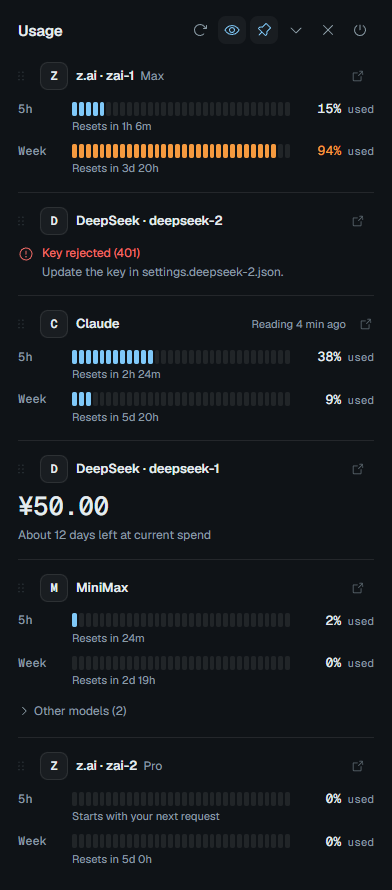

<div align="center">


# PawGauge

**Your AI plan usage, always in sight.**
A small tray and menu-bar widget that shows how much of your AI quota is left, with ShadowBlack keeping watch.

[](LICENSE)




</div>

## Download

**[Get the latest Windows installer](https://github.com/bilibalashadowpaw/PawGauge/releases/latest)**, free.

It is **not code-signed**, so Windows may warn you. The release page shows how to check your download. There is no macOS download yet; to run it there, see below.

## Why

AI plans hide their limits behind a settings page: a 5-hour window here, a weekly cap there, a prepaid balance somewhere else. PawGauge puts all of them in one small always-on-top panel, so you notice a limit *before* you hit it, not after.

- **One glance, every account.** Any number of accounts per service, each with its own meters.
- **Meters show how much you have used**, like the official usage screens. They turn orange at 90% and red at 100%. The tray icon and ShadowBlack's mood use the same thresholds.
- **Local and quiet.** No account, no cloud, no telemetry. Your keys never leave your machine except to the service they belong to.
- **A mascot who actually watches.** ShadowBlack perches on the window edge, gets drowsy when you step away, and hops when a quota refills. You can switch her off.

## Supported services

| Service | What you see | Where the numbers come from |
|---|---|---|
| **Claude** | 5-hour and weekly usage | `~/.claude/usage-snapshot.json`, written by the Claude Code status line from its `rate_limits` field. Only a live session on a Claude plan produces readings. |
| **z.ai** | 5-hour and weekly usage | `GET api.z.ai/api/monitor/usage/quota/limit` (undocumented) |
| **MiniMax** | Interval and weekly usage, per model family | `GET api.minimax.io/v1/token_plan/remains` (undocumented; only the `*_remaining_percent` fields are reliable) |
| **DeepSeek** | Prepaid balance and days left at your current spend | `GET api.deepseek.com/user/balance` (documented; the days-left estimate needs a day of history) |

Accounts are found automatically: PawGauge reads Claude Code's `settings.json` and `settings.*.json` and picks the service from each file's `ANTHROPIC_BASE_URL`. Each account also has a small link icon that opens that service's own usage or billing page.

| Service | Domains recognised (subdomains included) | Not supported yet |
|---|---|---|
| z.ai | `z.ai` | `bigmodel.cn` (mainland China) |
| MiniMax | `minimax.io` | `minimaxi.com`, `minimax.cn` (mainland China) |
| DeepSeek | `deepseek.com` | |

A key is only sent to the service its file points at. Relays, gateways and other hosts are skipped, even with a service's name in the address, and a mainland China key is not sent to the international servers. The address is checked again each time the key is read, so repointing a file while PawGauge runs does not send the new key to the old service.

### Claude plan usage

Claude has no key-based quota API, so the Claude row needs one setup step: Claude Code's status line must save the `rate_limits` it receives.

**On Windows**, open **Accounts…** from the tray menu and click **Set up…** under Claude usage. A system dialog shows the exact `statusLine` entry before anything is written, with Cancel as the default. Claude Code then runs PawGauge's PowerShell script (no Node.js needed), which is copied to `%APPDATA%\PawGauge`. Only that entry in `settings.json` changes. A status line you already have is never replaced, no backup copy is made (the file can hold keys), and a file that cannot be read as JSON is left alone. **Remove…** takes the entry out again, and so does uninstalling PawGauge. On a managed PC, a Group Policy execution policy overrides the command's `-ExecutionPolicy Bypass` and can stop the script from running. Windows PowerShell takes a moment to start, so the status line updates a little after each reply: about a quarter of a second on the PC it was measured on, and longer on a slower machine or on a first run.

**On macOS, or to set it up by hand**, point your `~/.claude/settings.json` at the Node.js script in this repo:

```json
{
  "statusLine": { "type": "command", "command": "node \"/path/to/PawGauge/tools/statusline-snapshot.js\"" }
}
```

It writes `~/.claude/usage-snapshot.json` (atomically) whenever a session on a Claude plan reports its limits, and prints `5h 38% · week 9%` as the status line. If you already have a status line, copy the `rate_limits` block from the script into yours instead. Until the first reading arrives the row says "No reading yet"; sessions on other backends carry no limits and leave the last reading alone. The snapshot is always in `~/.claude`, even if `CLAUDE_CONFIG_DIR` moves your settings. The row appears only when PawGauge finds Claude Code's folder or a snapshot. The Node.js script is not in the installer: download it from this repository; running it needs [Node.js](https://nodejs.org). To hide the Claude row, untick it on the Accounts screen.

> **Not affiliated.** PawGauge is an independent project. It is not affiliated with, endorsed by or sponsored by Anthropic, Z.ai, MiniMax or DeepSeek. Their names belong to them and appear only to identify each service; PawGauge shows a letter badge, not their logos.
>
> **Use at your own risk.** PawGauge sends your own key to each service's own endpoint, the same call their dashboards make. Two of those endpoints are undocumented, and a service may change, rate-limit or object to such calls. Check that your plan's terms allow it. The software comes with no warranty (see `LICENSE`).

> The z.ai and MiniMax endpoints are not officially documented and may change. If a response changes shape, the account shows "PawGauge needs an update" instead of a wrong number.

## Run it

```bash
git clone https://github.com/bilibalashadowpaw/PawGauge.git
cd PawGauge
npm install
npm start                # tray app; the window starts bottom-right and can be dragged
npm start -- --demo      # fixture data, no network, no keys needed
```

Click the tray (Windows) or menu-bar (macOS) icon to show or hide the window. **Esc** hides it. The header has buttons to refresh, keep the window on top, show or hide ShadowBlack, hide to the tray, and quit. "Start at login" is in the tray menu and is off by default.

Drag the header to move the window; it snaps to screen edges and remembers where you left it. The header's fold button collapses it to a small pill showing your most urgent account; drag the pill anywhere, and click it to expand again. The window grows away from the nearest screen edge so it stays fully visible, and ShadowBlack ducks, shrinks onto the pill, and hops back up when it expands. "Collapse when idle" in the tray menu folds it automatically after 30 seconds without the cursor on it (off by default).

### Build an installer

```bash
npm run dist        # Windows: dist/PawGauge Setup <version>.exe (per-user installer)
npm run dist:mac    # macOS: dist/PawGauge-<version>-arm64.dmg and -x64.dmg (must run on a Mac)
```

The builds are unsigned. Windows SmartScreen may warn on a downloaded copy. On a Mac without an Apple Developer ID, right-click the app and choose **Open** the first time (or `xattr -cr /Applications/PawGauge.app`).

On macOS the app is menu-bar only (no Dock icon). Left-click the icon to show or hide the window; right-click or ctrl-click opens the menu.

## Accounts and settings

If your settings are in the files above, you need no configuration. The **Accounts** screen opens the first time PawGauge runs, and again when no z.ai, MiniMax or DeepSeek account is found. Reopen it any time with **Accounts…** in the tray menu. It shows where PawGauge looked, the accounts it has, and why any file was skipped (file names and host names, never keys). **Refresh** reads the files again, so a new account needs no restart.

On that screen you can:

- **Show, hide or rename** an account. An empty name goes back to the automatic one.
- **Add a file…** from Claude Code's folder under any `.json` name. Its address must be on a supported service's domain, and the account stops if that address is later removed.
- **Choose its service…** for a file that has a key but no address. Claude Code uses a key like that with Anthropic, so only do this if you know the key came from the service you pick. A system dialog asks first, and Cancel is the default.
- **Remove** an account that was added this way or by hand.

Account choices are saved to PawGauge's own `accounts.json`; the only change the screen can make to a Claude Code file is the Claude usage status line described above. It does not ask you to type a key. If `accounts.json` cannot be understood, it is left as it is.

Things a tray app cannot see on its own:

- **Environment variables set in a terminal or shell profile** (`.zshrc`, `.bashrc`, a PowerShell session). An app opened from the Start menu, Finder or at login does not get them. This also applies to `"env"` below: the variable has to be visible to desktop apps (on Windows, a user environment variable, then restart PawGauge). A settings file is the more reliable choice, especially on macOS.
- **`CLAUDE_CONFIG_DIR` set only in a shell**, for the same reason. Set it as a user environment variable.
- **Other tools' config files.** PawGauge reads Claude Code's format only; for other tools use `accounts.json`.

To add an account that has no settings file, edit `accounts.json` in the app-data folder (`%APPDATA%\PawGauge` on Windows, `~/Library/Application Support/PawGauge` on macOS):

```json
{
  "overrides": { "zai-1": { "label": "z.ai main", "hidden": false } },
  "accounts": [
    { "id": "ds-work", "provider": "deepseek", "label": "DeepSeek work", "env": "DEEPSEEK_WORK_KEY" },
    { "id": "zai-3", "provider": "zai", "settings": "settings.zai-3.json" }
  ]
}
```

A `"settings"` name is relative to Claude Code's config folder. If that file has an `ANTHROPIC_BASE_URL`, it must be one of the provider's recognised domains; if it has none, the key goes to the provider you named.

Drag the grip at the left of an account to reorder it (or focus it and use the arrow keys); the order is remembered, and the header's sort button returns to automatic urgency order.

## Privacy and security

- Keys are read from disk at poll time, used for a single HTTPS request to the service's own endpoint, and dropped. They are never cached or logged, and PawGauge keeps no copy of one. The one time key text is written is Claude usage setup or removal: `settings.json` is rewritten with only its `statusLine` entry changed, so any key in it is carried over unchanged, through a temporary file beside it that is renamed over the original.
- The window is sandboxed, with context isolation and a strict content security policy. It never receives a key.
- The app stores only your preferences, your account choices (names, hidden accounts, added settings file names), a copy of its status-line script if you set up Claude usage, and a short history of balances and timestamps. No telemetry, no auto-update.
- Read [SECURITY.md](SECURITY.md) for details and how to report a problem.

## Add a service

Providers are code, accounts are data. Write `src/main/providers/<name>.js` exporting `fetchUsage(account, key)`, then register it in `src/main/providers/index.js` with a display name, a poll interval, the domains whose keys it may receive and the URL of its usage page.

`probe.py` is a read-only helper that calls each provider's quota endpoint once and prints the response *shape* (never a key), for checking what an endpoint returns.

## ShadowBlack

A transparent, click-through window perches on the top edge of the panel (`src/mascot`, `src/main/mascot.js`). She peeks over the edge and breathes; her mood follows your worst account: calm when you are fine, an amber halo from 90% used, waving with a rose halo when something is fully used up, and a celebration when a quota recovers. She gets drowsy after 90 seconds without input, sleeps after five minutes, and her head follows your cursor. Turn her off with the eye button in the header or "ShadowBlack" in the tray menu.

Her sprites are built from the official character master by `tools/make_sprites.py` and are not part of the MIT licence (see below).

## Update log

| Version | What's new |
|---|---|
| **0.4.43** | Set up Claude usage from the Accounts screen on Windows, no Node.js needed. Remove or uninstall takes it out again |
| **0.4.42** | New Accounts screen to show, hide, rename and add accounts. A settings file switched to another service now updates by itself, with the right badge and link |
| **0.4.41** | Key safety fix, `settings.json` is read too, and a new account check shows why an account is missing |
| **0.4.40** | Each account is tinted in its service's colour |
| **0.4.37** | Simpler app and tray icon |
| **0.4.36** | Fixed: clicking ShadowBlack while she hides could do nothing |
| **0.4.12 - 0.4.22** | Tuck PawGauge away at the left or right screen edge |
| **0.4.9** | Drag the window, or collapse it to a small pill |
| **0.4.7** | Renamed to PawGauge |
| **0.4.3** | macOS support |
| **0.3.0** | ShadowBlack arrives |

## Licence

- **Code:** [MIT](LICENSE).
- **ShadowBlack and the PawGauge icon:** all rights reserved, see [ART-LICENSE.md](ART-LICENSE.md). Forks should replace `src/mascot/`, `src/assets/tray/` and the icon files in `build/`, and use another name.
- **Third-party:** Geist fonts (SIL OFL 1.1) and Phosphor Icons (MIT). Full notices: [THIRD_PARTY_NOTICES.md](THIRD_PARTY_NOTICES.md). Contributing: [CONTRIBUTING.md](CONTRIBUTING.md).

<div align="center">

Made by **Bilibala Shadowpaw Limited**

</div>
